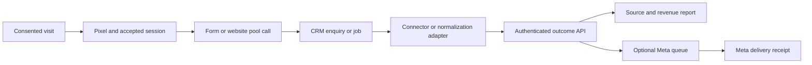

# Set up website to CRM attribution

Connect a website visit to a real enquiry, booking or payment, and optionally send eligible outcomes to Meta. Use PipelineOn or run the MIT kit on your own server. For an AI-assisted installation, give your coding assistant [AI-SETUP.md](AI-SETUP.md), your setup brief and this repository.

## Pick the instructions for your setup

- **Server, free options or Railway:** [setup recipes](SETUP-RECIPES.md#choose-hosting-and-understand-free-options).
- **Website pixel through GTM:** [GTM walkthrough and tag code](GTM.md).
- **Optional Worker in front of the pixel:** [Worker recipe and code](SETUP-RECIPES.md#put-the-pixel-behind-an-optional-cloudflare-worker).
- **Facebook:** [Meta account, token and testing steps](META-SETUP.md).
- **Offline activity, CSV or CRM middleware:** [connection recipes](SETUP-RECIPES.md#normalize-offline-activity-and-connect-your-crm), then [field mapping](FIELD-MAPPING.md).

## Choose your installation

| Choice | You provide and operate |
| --- | --- |
| PipelineOn | Website access, a website-scoped API key or supported connector, source-system access and any custom CRM adapter. PipelineOn operates the attribution service. |
| Self-hosted MIT kit | A server with persistent storage, a tracking subdomain, source-system access, HTTPS, backups, monitoring and any custom adapter. |

An existing CRM workflow or your backend may remove the need for a separate relay. A Cloudflare Worker is optional middleware; the current Node.js and SQLite kit does not run unchanged in a Worker. See [DEPLOYMENT.md](DEPLOYMENT.md).

These examples use the v0.3 outcome contract. Read the documentation at the same commit as your installed code. Google click capture and Google Ads delivery are separate. Version 0.3 includes optional Data Manager API delivery; follow [EVENTS.md](EVENTS.md) for canonical business facts and [GOOGLE-ADS.md](GOOGLE-ADS.md) for account setup, validation and processing receipts. A captured parameter alone never requests delivery.

## Follow the setup order

| Step | Action | Proof before continuing |
| --- | --- | --- |
| 1 | Select PipelineOn or deploy the kit with [DEPLOYMENT.md](DEPLOYMENT.md). | Correct website configured; private writes reject missing credentials. |
| 2 | Follow [PIXEL-EVENTS.md](PIXEL-EVENTS.md). | A tagged visit produces an accepted session after consent. |
| 3 | Carry the session into your enquiry. | The saved form/CRM record contains the same reference, or explicitly has no match. |
| 4 | Complete [FIELD-MAPPING.md](FIELD-MAPPING.md). | Source objects, IDs, event meanings, timestamps and payment units are mapped. |
| 5 | Connect the source using [INTEGRATIONS.md](INTEGRATIONS.md). | An actual source test record reaches the importer once, with a receipt. |
| 6 | Add CallRail if required with [CALLRAIL.md](CALLRAIL.md). | A website-pool call carries the actual captured session cookies. |
| 7 | Configure [Meta setup and test mode](META-SETUP.md). | A recent synthetic event has a stored delivery receipt and a Test Events entry. |
| 8 | Complete [ACCEPTANCE.md](ACCEPTANCE.md). | Attribution, revenue, replay, recovery and customer experience checks pass. |

## Record the business decisions

Identify website origins, environment, CRM account/company, form provider, enquiry/job/payment objects, currency, timezone and existing advertising senders. For CallRail, identify the company and website number pool. [CRM-ACCESS.md](CRM-ACCESS.md) covers provider access options; verify access on the customer's subscription.

Choose one system as the authority for each payment and one server sender per advertising conversion. A processor and CRM may describe the same payment. Importing both under different IDs doubles local revenue even if an advertising platform deduplicates a conversion.

Use a separate QA website/database for synthetic records. Labeling a production payment “test” does not exclude it from revenue reports. Keep advertising disabled until source attribution works, then use a test destination/code.

## Know what is included

The kit includes its pixel, outcome API, attribution reports, Meta queue, read-only assistant tools and optional CallRail connector. It does not include a generic CRM login, automatic interpretation of arbitrary CRM fields or a universal Cloudflare relay. Your backend, workflow or adapter supplies normalized outcomes.

PipelineOn has hosted integration settings, including HubSpot and CallRail, plus the generic API. Verify which activities a native connector already imports before adding an adapter. The kit runs independently; hosted subscription features are separate.

## Read the receipts in sequence

A pixel request proves an attempt. An accepted session proves a collected visit. A saved CRM record proves an enquiry. An import receipt proves ingestion. A linked report proves the source join. A Meta acceptance receipt proves provider acceptance. None alone proves the next step, a matched person or improved advertising performance.

When a stage fails, repair that stage using its retained receipts. Never invent a session or refresh event IDs/timestamps to make a test pass. Start with one website, one successful form, one payment and one verified advertising receipt before adding more CRM stages.
