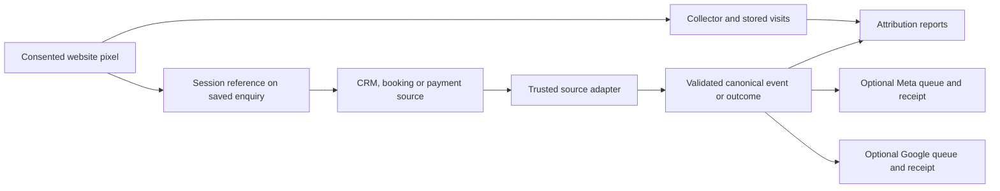

# Architecture and project status

This guide explains the public baseline and where to extend it. It does not provision hosting or implement customer onboarding. Start with [deployment models](deployment-models.md) before choosing infrastructure or building a connector.

## Data flow

The website script records observed visits. The source adapter records confirmed business facts and carries the original accepted session reference when available. Reports join that evidence. Destination workers deliver eligible conversions independently of report reads. An offline payment does not travel back through the browser script; see [offline-event mapping](offline-event-mapping.md).

## Design boundaries and their consequences

| Boundary in the current code | Consequence for an extension |
| --- | --- |
| One site configuration, SQLite file and process | Small installations need no separate database service. Multiple unrelated customers need isolated instances or a separately implemented tenant model. |
| Shared event contract between source adapters and destinations | Implement each CRM's source/authentication behavior once; configure its fields and business meanings per connection. Do not implement a new Meta sender inside every CRM adapter. |
| Source IDs, original times and ordered revisions | Preserve replay/correction semantics when adding a provider. Never turn a retry into a new payment. |
| Observed attribution separated from verified identity | Missing evidence remains unlinked; browser similarity does not create a person or campaign match. |
| Local facts separated from advertising eligibility | An outcome can appear in reports without requesting an ad conversion. Advertising needs its own envelope, consent, matching data and destination. |
| Independent durable delivery queues and receipts | Import success does not mean delivery success. Local corrections do not retract a conversion already accepted by a provider. |
| Separate read/write secrets and temporary dashboard sessions | The shipped dashboard supports operator read access. Customer accounts, roles and provider OAuth callbacks are additional application work. |

These are observable implementation choices, not promises about an unimplemented future architecture. For exact field and endpoint behavior, the checked-out validators and [API guide](api.md) take precedence over a general description.

## Source map

| Change | Start here |
| --- | --- |
| Install configuration and runtime | [setup](../server/setup.mjs), [launcher](../server/start.mjs), [hosting](hosting.md) |
| Website collection, navigation and enquiry reference | [pixel](../public/pixel.js), [pixel guide](pixel.md) |
| HTTP authentication and endpoint dispatch | [app](../server/app.mjs) |
| Persisted visits, outcome revisions and report assembly | [store](../server/store.mjs) |
| Canonical event meanings and input validation | [events](../core/events.mjs), [validation](../core/validation.mjs), [event guide](events.md) |
| Campaign observations and attribution calculation | [tracking](../core/tracking.mjs), [UTMs](../core/utm.mjs), [reporting](../core/reporting.mjs) |
| Verified people and browser candidate evidence | [person store](../server/person-store.mjs), [continuity store](../server/continuity-store.mjs), [people](people.md), [browser continuity](browser-continuity.md) |
| A new CRM adapter | [mapping workflow](offline-event-mapping.md), [CRM contract](crm.md), [private mapping worksheet](../examples/crm-mapping.template.json) |
| Existing CallRail source adapter | [receiver/worker](../server/callrail.mjs), [store](../server/callrail-store.mjs), [CallRail guide](callrail.md) |
| Destination payload and eligibility | [Meta](../core/meta.mjs), [Google](../core/google.mjs), [matching-data helper](../server/matching.mjs) |
| Destination persistence and workers | [Meta store](../server/meta-store.mjs), [Meta worker](../server/meta-delivery.mjs), [Google store](../server/google-store.mjs), [Google worker](../server/google-delivery.mjs) |

Put a new source adapter outside the browser and keep its provider credentials private. Reuse the canonical contract and existing destination workers. Tests in `test/` cover the standalone contracts, HTTP behavior, persistence and documentation links; some provider responses are simulated.

## Shipped, installation-specific and future work

Public release baseline reviewed: **v0.4.3**, 28 October 2026. Read `package.json` and the checked-out source for the version you actually install; this guide does not upgrade a deployment.

| State | Scope |
| --- | --- |
| Shipped baseline | Consented visit collection, observed attribution, outcome/event APIs, SQLite persistence, reports/export, read-only dashboard/MCP, browser continuity evaluation, verified person-link interfaces, CallRail adapter, optional Meta/Google delivery. |
| Required for each installation | Hosting/HTTPS/disk, website and consent wiring, source account access, real field/relationship mapping, authoritative events, provider destinations where requested, backups/monitoring and acceptance evidence. |
| Custom source integration | Most CRM authentication/synchronization, polling/webhook durability and provider-specific field discovery. Pure mapping helpers are not complete connectors. |
| Additional product development | Multi-tenant signup/login and roles, connection UI/OAuth, tenant-aware storage/queues/credentials, per-customer setup, disconnect/deletion and provider approval work. See [multi-tenant build sequence](deployment-models.md#build-a-multi-tenant-product). |
| Outside current baseline | Universal CRM login, automatic bidding/spend reporting, conversion retractions/refund automation, automated full physical erasure/retention, proprietary anonymous identity and predictive LTV. |

No launch dates are implied for additional product development. A successful test suite or old installation receipt does not certify a new customer's connection. [Verification](verify.md) specifies the evidence to collect.

## Relevant public history

| Release / change | Why it matters to an implementer |
| --- | --- |
| [v0.3.7](https://github.com/Zaclive/pipelineon-attribution-kit/releases/tag/v0.3.7) and [v0.3.8](https://github.com/Zaclive/pipelineon-attribution-kit/releases/tag/v0.3.8) | Person IDs, campaign history and direct HubSpot references; a trusted adapter still establishes the source evidence. |
| [SPA navigation PR](https://github.com/Zaclive/pipelineon-attribution-kit/pull/2) and [hash-route PR](https://github.com/Zaclive/pipelineon-attribution-kit/pull/3) | The pixel observes supported navigation automatically; redundant router tracking can double-count. |
| [Agent-led setup and browser evaluation](https://github.com/Zaclive/pipelineon-attribution-kit/pull/4) | Documents browser matching as evidence evaluation, separate from verified identity. |
| [Cold-agent setup review](https://github.com/Zaclive/pipelineon-attribution-kit/pull/6) | Clarifies Node-only local startup, configuration generation and dashboard sign-in. Its reported trial is historical evidence, not a current customer installation. |
| [v0.4.3 own-account setup](https://github.com/Zaclive/pipelineon-attribution-kit/releases/tag/v0.4.3) | Separates private advertiser setup from platform onboarding. The release reports documentation/tests, not a real advertiser authorization or conversion send. |

Use [releases](https://github.com/Zaclive/pipelineon-attribution-kit/releases) for published artifacts and [pull requests](https://github.com/Zaclive/pipelineon-attribution-kit/pulls) for proposed changes. For example, bot/ad-block diagnostics in [PR #1](https://github.com/Zaclive/pipelineon-attribution-kit/pull/1) were unmerged at this review and are not part of v0.4.3. Check current status before relying on a proposal. Keep installation decisions and receipts privately with that installation; public project history cannot supply customer credentials or field definitions.
