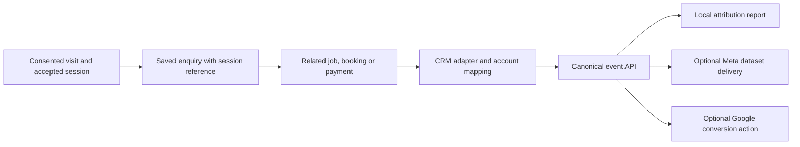

# Map offline outcomes and send conversion feedback

The kit provides a common event contract and optional Meta/Google senders. The installer supplies the connection from the business's actual CRM, booking, call or payment system. For one business and one CRM, build/configure this connection once and maintain it. For many customers, reuse the CRM adapter and configure each account separately; see [deployment models](deployment-models.md).

## What goes back to the pixel

There are two different destinations:

- **Local attribution:** an accepted `visitorSessionId` carried from the original enquiry links a later outcome to stored visits. The kit's website script does not need to run again when that outcome occurs.
- **Advertising feedback:** the server sends an eligible outcome to the configured Meta dataset/pixel ID through Conversions API, or to a Google Ads conversion action through Data Manager API. This is server delivery, not a message sent back to browser JavaScript.

An offline payment may occur while the customer is away from the website. Do not invent a thank-you-page visit or trigger a browser purchase for it. If an existing browser event represents the same conversion, coordinate deduplication with that sender. A dataset/pixel ID identifies a Meta destination; the kit's `visitorSessionId` identifies local visit evidence. Neither is a replacement for permitted ad-matching data.

## Separate adapter code from connection configuration

| Layer | Build/reuse | Configure and verify per connection |
| --- | --- | --- |
| CRM provider adapter | Authentication mechanism, API client, webhook verification or polling, pagination, object relationships and normalization | Actual account/company ID, credentials/scopes, webhook subscription, cursor and rate-limit state |
| Business mapping | Supported mapping primitives and validation | Real custom-field IDs, stage/status IDs, what counts as qualified/booked/paid, source timezone and currency units |
| Visit linkage | Read and propagate the original enquiry reference | Which form/enquiry field holds it and how this account's job/payment relates to that enquiry |
| Shared attribution engine | Canonical event validation, revisions, reporting and destination workers | Intended website instance and one authoritative source for each logical outcome |
| Advertising | Existing Meta/Google payload, eligibility, deduplication and retry code | Customer dataset/advertiser/action IDs, private credentials, consent/provenance, matching fields and sender ownership |

A Connect button authorizes an account. It does not determine that account's meaning of "won", "qualified" or "paid". Those choices may be suggested from a standard schema, but custom fields and business definitions must be checked. Keep connection settings and receipts private; the [CRM worksheet](../examples/crm-mapping.template.json) is a design aid, not executable configuration.

## Implement one source connection

1. **Choose authoritative facts.** Identify the actual source objects and relationships. Use the CRM for enquiries or qualification if appropriate, and the payment processor/accounting system for collected money when the CRM does not expose it. Choose one authority per logical payment to avoid duplicates across systems.
2. **Capture the join at the enquiry.** Save the accepted session through the existing successful form handler, then retain it on the enquiry/job used by later bookings and payments. Do not overwrite every historical job with the contact's latest visit. See [pixel/form instructions](pixel.md#carry-the-reference-into-the-enquiry).
3. **Receive changes reliably.** Authenticate provider webhooks and persist an inbox before acknowledging, or poll with a durable cursor, overlap and pagination. Refresh authoritative state when notifications are incomplete. Your adapter owns inbound retries/reconciliation; the kit's ad queues do not fetch missed CRM changes.
4. **Normalize the event.** Use a stable source/account namespace and activity ID, the original occurrence time, a trustworthy source revision and the actual relationship to the enquiry. Convert money exactly to integer minor units. Apply [canonical meanings](events.md) and [field rules](crm.md#map-the-contract-fields).
5. **Import and read back.** Prefer `POST /v1/events` for a new canonical integration; `/v1/outcomes` remains supported. Use the write token only on your trusted server. Verify the stored outcome and its report separately. PipelineOn's hosted wrapper is different: follow [the API guide](api.md#send-to-the-correct-api).
6. **Add advertising separately.** Configure the intended destinations, then supply the optional `meta` and/or `googleAds` envelope from permitted first-party evidence. An imported payment with no envelope records local revenue only. Use the actual channel where the conversion happened, not simply "CRM" because a CRM delivered the record.
7. **Prove each stage.** Retain source, import, attribution and provider receipts; test exact replay, correction, missing references, denied consent and restart. Start in Meta Test Events and Google validate mode. Validation is not live delivery; provider acceptance is not proof of ad matching or performance improvement.

Missing or ambiguous session context leaves the successful outcome unlinked locally. It can still be eligible for advertising when independent, permitted matching data exists. Never fabricate a session or a click ID to complete the chain.

## Map the business milestone

The source conditions below are examples of business evidence to find, not universal CRM API field names. Map the actual account's schema.

| Verified source fact | Canonical event | Stock Meta mapping | Stock Google mapping |
| --- | --- | --- | --- |
| Enquiry persisted successfully | `lead_received` | `Lead` | Configured action for `lead_received` |
| Explicitly qualified form or answered call | `lead_qualified` with `channel: "form"` or `"call"` | `Lead` | Configured action for `lead_qualified` |
| Appointment confirmed | `appointment_booked` | `Schedule` | Configured action for `appointment_booked` |
| Estimate issued | `estimate_sent` | No default delivery | Configured action for `estimate_sent` |
| Job/opportunity confirmed won | `job_won` | No default delivery | Configured action for `job_won` |
| Payment actually completed | `payment_received` | `Purchase` with known amount/currency | Configured action for `payment_received`, with value |

These are the kit's mappings; eligibility and destination configuration still apply. The stock Meta mapper sends both lead milestones as `Lead`; it does not implement a separate qualified-lead optimization event. Labels do not change that behavior. Decide whether qualification corrects an existing lead or is a genuinely distinct milestone. Reusing an event ID after it has been sent is not a supported way to deliver another stage; two separate Lead events can also double-count if the intended metric is one lead. Agree the conversion ownership/metric first, and extend the mapping deliberately if a different provider contract is required.

Won-job value is not collected payment value. Deposits and balances are distinct transactions; refunds/cancellations are not new positive purchases. The current kit does not automate downstream refunds/retractions. Follow [event delivery behavior](events.md#delivery-behavior) before handling corrections after a send.

## Supply matching data explicitly

The kit stores permitted campaign/click observations, but importing a session reference does **not** automatically populate an ad envelope. The adapter must supply consent and matching fields using the destination's supported contract.

| Purpose | Source to preserve | Rule |
| --- | --- | --- |
| Local campaign attribution | Accepted session on the original enquiry/job | Preserve through the source relationship; UTMs are source evidence, not person identifiers. |
| Meta matching | Permitted customer-provided identifiers and, when actually observed and permitted, `fbp`/`fbc` | The kit does not automatically read Meta cookies. Normalize/hash identifiers on the server with [matching helpers](events.md#identity-matching-and-consent); never invent cookie data. |
| Google matching | Original permitted `gclid`/`gbraid`/`wbraid`, or supported customer-provided email/phone hashes | Capture/preserve through the consented integration; send using the [Google envelope](google-ads.md#request-a-conversion). Do not send UTM campaign values as click IDs. |
| Consent and origin | Recorded permissions and the real website/phone/store/etc. source | A CRM connection or session reference does not grant ad consent. Website Meta events additionally require the real source URL and user agent. |

For a conversion already sent by another integration, use `deliveryOwner: "external"` for that provider unless intentionally transferring ownership. Browser/server copies need coordinated provider identity; see [Meta deduplication](meta.md#deduplication-retries-and-corrections) and [Google delivery](google-ads.md). Do not rewrite old occurrence times to fit provider limits or replay validation/test history as new live conversions.

## Acceptance for each customer account

Keep a redacted source sample, approved field mapping and expected normalized payload; then record the saved enquiry/reference, stored event, exact amount/currency, linked or explicitly unlinked report and destination receipts. Run [verification](verify.md) for each account and event type you enable. Adapter tests can be reused across customers, but they cannot prove the next customer's credentials, custom fields, session relationship or ad destination.
