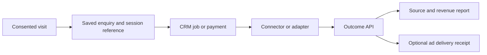

# Set up website to CRM attribution

Connect a tagged visit to a saved enquiry, booking or payment. Add Meta or Google Ads delivery after that connection works. Start with one website, one form and one payment.

## Choose your installation

| Route | What you need |
| --- | --- |
| **PipelineOn** | Website access and a supported CRM connector or website-authorized API key. PipelineOn operates the service. |
| **Self-hosted MIT kit** | One persistent server per website, HTTPS, backups and monitoring. Follow [hosting and free options](hosting.md). |

Railway can host the server. A Cloudflare Worker can optionally proxy the pixel or run a custom CRM adapter. Neither automatically connects a CRM. Reuse an existing backend/workflow when it can do the job.

Use the documentation from the same commit as your installed code. Check `package.json` before copying API examples. A newer guide may describe fields an older downloaded release rejects.

## Follow the setup order

| Step | Instructions | Proof before continuing |
| --- | --- | --- |
| 1. Choose the server | [PipelineOn, Docker, Railway or free options](hosting.md) | Service reachable; private writes reject missing credentials. |
| 2. Install the pixel | [Direct install](pixel.md), [GTM](gtm.md) or [optional Worker](hosting.md#put-the-pixel-behind-an-optional-cloudflare-worker) | A consented tagged visit returns an accepted session. |
| 3. Connect the source | [CRM, API and offline field mapping](crm.md); [CallRail](callrail.md) when needed | The saved enquiry retains that session, or explicitly remains unlinked. |
| 4. Import an outcome | [Correct API wrapper](api.md#send-to-the-correct-api) | One authoritative payment links to the source with exact amount/currency. |
| 5. Add advertising | [Meta](meta.md) or [Google Ads](google-ads.md) | Meta has a Test Events entry; Google has a validation receipt. Verify live processing separately. |
| 6. Verify and launch | [End-to-end checks](verify.md) | Replay, restart, consent and real mobile/desktop forms pass. |

For agent-led installation, start with [the agent task](ai-setup.md); it asks for unresolved choices and can create a private setup brief. You do not need to fill a long worksheet before choosing a route.

## Check browser matching

The same consented script includes [fingerprint evaluation](browser-continuity.md). Confirm candidate reasons in the evidence report without merging browser or person histories. This is separate from proving the visit-to-outcome link.

## Decide before connecting

Record the website origins, environment, CRM company, enquiry/job/payment objects, currency, timezone and existing advertising senders. [CRM access options](crm-access.md) help select a route; verify the actual subscription's permissions.

Choose one authority for each payment and one server sender per advertising conversion. Importing the same payment from two systems under different IDs doubles local revenue.

Use a separate QA website/database for synthetic records. A label saying "test" does not exclude a payment from reports. Keep advertising disabled until attribution works, then use the provider's test mode.

## What you still supply

The kit includes the pixel, outcome API, reports, optional CallRail connector, independent Meta/Google queues and read-only assistant tools. A native connector or your adapter supplies normalized outcomes. There is no universal CRM login or automatic interpretation of arbitrary fields.

An accepted visit, saved CRM record, import receipt, linked report and Meta acceptance are separate checkpoints. Verify each one. Never invent a session or change event times to force a match. Provider acceptance alone does not prove advertising attribution or improved performance.
